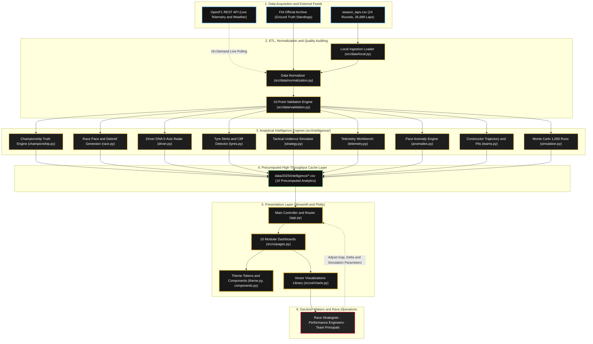

# ⚡ F1 Super Intelligence Platform (2025 Season)

[](https://www.python.org/)
[]()
[-gold.svg)]()
[]()
[]()

An enterprise-grade Formula 1 race engineering intelligence platform combining historical race analytics, driver performance DNA, tyre degradation cliffs, tactical pit battle simulation, full-grid safety car neutralizations, synchronized telemetry overlays, statistical anomaly detection, and Monte Carlo predictive race simulations across the **complete 2025 F1 Season (24 Rounds, 26,689 Laps, 21 Drivers, 10 Constructors)**.

---

## 🏆 Official 2025 Championship Result (Ground Truth)
- **World Drivers' Champion:** 🥇 **Lando Norris** (McLaren) — 421 pts
- **Runner-Up:** 🥈 **Max Verstappen** (Red Bull) — 344 pts
- **Third Place:** 🥉 **Oscar Piastri** (McLaren) — 330 pts
- **Constructors' Champion:** 🏆 **McLaren**

---

## 🚀 Quick Start

### 1. Installation
`ash
pip install -r requirements.txt
`

### 2. Run Sanity Checks & Test Suite
`ash
# Run complete 56-test pytest suite
pytest tests/ -v

# Run platform smoke test & season dataset audit
python scripts/smoke_test.py
python scripts/audit_season.py
`

### 3. Build / Rebuild Precomputed Intelligence Cache
`ash
python scripts/build_race_intelligence.py
`

### 4. Launch the Interactive Dashboard
`ash
streamlit run app.py
`

---

## 🌟 Feature-by-Feature Deep Dive

The platform delivers 10 specialized intelligence modules accessible via the sidebar navigation:

`
├── 1. 🏠 Command Center (Season Executive Dashboard)
├── 2. 🏁 Race Intelligence (Single GP Deep Dive & Automated Debriefs)
├── 3. 👤 Driver Intelligence (5-Axis Performance DNA & Season Evolution)
├── 4. ⚔️ Driver Comparison (Head-to-Head & Relative Pace Delta)
├── 5. 🛞 Strategy & Tyres (Degradation Slopes & Undercut Simulator)
├── 6. 🏎️ Telemetry Lab (Speed Traces, Multi-Channel & Apex Speeds)
├── 7. 🚨 Anomaly Center (Z-Score Outliers & Pace Collapses)
├── 8. 🏭 Team Intelligence (Constructor Trajectories & Pit Efficiency)
├── 9. 🎲 Race Simulator (Monte Carlo 1,000-Iteration Outcome Predictor)
└── 10. 📋 Data Quality Audit (Validation Engine & Transparency Hub)
`

---

### 1. 🏠 Command Center (Season Executive Summary)
- **Championship Banner:** Displays the verified 2025 World Champion (Lando Norris, 421 pts) and top-3 podium standings with official FIA badges.
- **Season Milestone Metrics:** Total laps analyzed (26,689), calendar completion (24/24 rounds), number of active drivers (21) and constructors (10).
- **Driver Points Progression:** Interactive multi-driver cumulative points chart tracking round-by-round title swings.
- **Season Heatmap:** Comprehensive Driver × Race grid showing finishing positions or representative pace across all 24 calendar rounds.

### 2. 🏁 Race Intelligence & Automated Debriefs
- **Grand Prix Selector:** Instant drill-down into any of the 24 rounds (from Round 1 Australia to Round 24 Abu Dhabi, including Azerbaijan).
- **Representative Pace Violin Distribution:** Kernel density estimation of clean race pace per driver with outlier filtering.
- **Rolling Pace Battle Tracker:** 3-lap rolling average pace comparisons between leaders or selected rival drivers.
- **Position Progression Chart:** Lap-by-lap position tracking from grid start to chequered flag (inverted Y-axis with P1 on top).
- **Intra-Team Teammate Battles:** Head-to-head comparison within constructor pairings (gap, median pace, finishing delta).
- **Automated Evidence-Backed Race Debrief:** Algorithmic narrative generator detailing key strategic pivots, pace turning points, and decisive laps.

### 3. 👤 Driver Intelligence & 5-Axis Performance DNA
- **5-Axis Empirical Radar Chart:** Evaluates drivers across 5 percentile dimensions (0–100 score normalized against 2025 grid):
  - **Raw Pace:** Fastest 20% clean lap times.
  - **Consistency:** Inverse coefficient of lap time variation.
  - **Racecraft:** Net positions gained vs grid start.
  - **Tyre Management:** Stint longevity and low degradation gradient.
  - **Finishing Rate:** Percentage of classified race finishes.
- **Rolling Form Momentum:** 3-race moving average finish position and pace trend.
- **Relative Pace Delta Index (RPDI):** Driver's median lap time delta expressed as % difference to race-winning pace.
- **Season Milestones:** Automated detection of wins, podiums, fastest laps, and notable recovery drives.

### 4. ⚔️ Driver Comparison & Head-to-Head Hub
- **Direct Multi-Driver Comparison:** Side-by-side metric cards (wins, podiums, poles, avg finish, avg pace).
- **Overlaid Performance Radars:** Dual-spider chart highlighting contrasting driving styles and strengths.
- **Season-Long Gap Progression:** Head-to-head delta over 24 rounds showing who out-developed their rival.
- **Teammate Differential Analysis:** Compares intra-team drivers in identical machinery to isolate pure driver talent.

### 5. 🛞 Strategy & Tyre Intelligence + Undercut Feasibility Simulator
- **Compound Benchmark Matrix:** Comparative breakdown of Soft, Medium, Hard, and Intermediate tyres (pace, lifespan, degradation rate).
- **Tyre Degradation Curves:** Linear regression degradation slopes (s/lap) per compound and stint.
- **Tyre Performance Cliff Detector:** Identifies sudden >0.8s consecutive lap drop-offs indicating thermal degradation or graining.
- **Strategy Gantt Chart:** Visual stint sequences displaying compound allocations and pit stop lap windows for the entire grid.
- **Tactical Undercut Feasibility Simulator:** Interactive predictive calculator where race engineers can test:
  - Current gap to car ahead (seconds)
  - Expected fresh tyre delta (s/lap)
  - Laps before target car responds with a pit stop
  - Outputs feasibility, confidence rating, total out-lap gain, and projected track exit margin.

### 6. 🏎️ Telemetry Lab
- **Synchronized Distance-Based Speed Traces:** High-resolution speed (km/h) overlays across normalized track distance (0–100%).
- **Multi-Channel Synchronized Telemetry:**
  - Speed (km/h)
  - Throttle Application (0–100%)
  - Braking Pressure (0–100%)
  - Gear Selection (1–8)
- **Turn-by-Turn Apex Delta:** Minimum cornering apex speeds and throttle pickup points across critical braking zones.

### 7. 🚨 Anomaly Center
- **Z-Score Pace Outlier Engine:** Flags anomalous laps where Z-score exceeds 2.2 standard deviations.
- **Sudden Pace Collapse Detector:** Identifies multi-lap sustained drop-offs (>1.5s per lap) caused by mechanical damage, debris, or tyre punctures.
- **Severity Rating System:** Flags anomalies as CRITICAL, WARNING, or INFO with contextual root-cause evidence.

### 8. 🏭 Team Intelligence
- **Constructor Season Development Trajectory:** 24-round rolling pace performance curves tracking factory upgrade cycles.
- **Teammate Contribution Split:** Percentage contribution of each driver to the team's total points and podium tallies.
- **Pit Stop Efficiency Index:** Pit duration consistency, median pit lane time loss, and error frequency.

### 9. 🎲 Monte Carlo Race Outcome Simulator
- **1,000-Iteration Stochastic Simulator:** Simulates prospective or historical race outcomes factoring in:
  - Driver historical baseline pace and variance
  - Qualifying grid penalty probabilities
  - Safety car neutralization likelihood
  - Tyre degradation stochasticity and pit stop execution
- **Probability Breakdown:** Computes probabilistic **Win %**, **Podium %**, and **Points Finish %** distributions per driver.

### 10. 📋 Data Quality Audit Hub
- **Transparent Health Monitoring:** Real-time audit report across all 26,689 dataset rows.
- **10-Point Health Checks:** Schema integrity, duplicate rows, missing timestamps, compound validity, and calendar coverage.
- **Zero-Hidden-Error Principle:** Surfacing all warnings, missing stint tags, and calibration notes without masking data artifacts.

---

## 📐 Mathematical & Statistical Methodologies

| Metric | Formulation / Logic | Purpose |
|---|---|---|
| **Representative Pace** | Trimmed mean (5%) of clean lap times | Excludes pit in/out laps, yellow flags, and safety car laps |
| **Consistency Score** | 100 * (1 - min(1, std / mean)) | Measures lap-to-lap rhythm and variance control |
| **Degradation Slope** | Linear regression slope across stint laps | Linear tyre degradation rate (s/lap) |
| **Tyre Cliff** | Consecutive lap time loss > 0.8s | Detects critical thermal/graining performance cliff |
| **Safety Car Detection** | Median grid lap time > 1.35x baseline | Automated flag-free neutralization recognition |
| **VSC Detection** | Median grid lap time > 1.18x baseline | Automated Virtual Safety Car detection |
| **Pace Anomaly Z-Score** | (Lap Time - Driver Mean) / Driver Std | Flags statistical outliers (Z > 2.2) |
| **Undercut Feasibility** | (Fresh Tyre Gain * Laps) - Target Gap | Predicts on-track track position gain |

---

## 🏛️ System Architecture



### 📁 Repository Structure

```text
F1-Super-Intelligence-Platform/
├── app.py                             # Streamlit multi-page application entrypoint
├── config.py                          # Master configuration & design token constants
├── requirements.txt                   # Production dependencies
│
├── data/2025/
│   ├── raw/                           # Raw telemetry and timing feeds
│   ├── processed/
│   │   └── season_laps.csv            # 24-round normalized dataset (26,689 laps)
│   └── intelligence/                  # Precomputed high-speed CSV caches
│       ├── race_intelligence.csv
│       ├── driver_profiles.csv
│       ├── driver_evolution.csv
│       ├── tyre_intelligence.csv
│       ├── strategy_intelligence.csv
│       ├── team_trajectory.csv
│       ├── team_contributions.csv
│       ├── team_pit_efficiency.csv
│       ├── anomaly_events.csv
│       └── data_audit_report.csv
│
├── src/
│   ├── data/                          # Ingestion, normalization & validation
│   │   ├── local.py                   # CSV loader and caching
│   │   ├── normalization.py           # Name, compound, and circuit canonicalization
│   │   └── validation.py              # Data quality audit framework
│   ├── intelligence/                  # Core analytical intelligence engines
│   │   ├── championship.py            # Official standings & validation rules
│   │   ├── race.py                    # Race summaries, pace battles & debriefs
│   │   ├── driver.py                  # Driver performance DNA & milestones
│   │   ├── tyres.py                   # Stint analysis & cliff detection
│   │   ├── strategy.py                # Undercut battles & feasibility simulator
│   │   ├── context.py                 # Neutralizations & race timeline replay
│   │   ├── telemetry.py               # Speed traces & multi-channel telemetry
│   │   ├── anomalies.py               # Statistical pace anomaly engine
│   │   ├── teams.py                   # Constructor development & pit efficiency
│   │   ├── simulation.py              # Monte Carlo 1,000-iteration race simulator
│   │   └── engine.py                  # Pipeline orchestrator
│   ├── ui/                            # Presentation layer
│   │   ├── theme.py                   # Black & Gold luxury styling & CSS tokens
│   │   ├── components.py              # Reusable KPI cards, banners & badges
│   │   ├── charts.py                  # Plotly visualizations
│   │   └── pages.py                   # 10 full-page interactive renderers
│   └── utils/                         # Helpers and statistical functions
│       ├── metrics.py                 # Pace, consistency, and trimmed statistics
│       └── logging.py                 # Standardized logging utilities
│
├── scripts/
│   ├── build_race_intelligence.py     # Batch processing precomputation pipeline
│   ├── smoke_test.py                  # 26-point end-to-end platform sanity test
│   ├── audit_season.py                # 24-round dataset completeness audit
│   └── generate_season_report.py      # Automated season summary generator
│
└── tests/                             # 56-test comprehensive test suite
    ├── test_anomalies.py
    ├── test_championship.py
    ├── test_context.py
    ├── test_data.py
    ├── test_driver_metrics.py
    ├── test_race_metrics.py
    ├── test_simulation.py
    ├── test_strategy.py
    ├── test_teams.py
    ├── test_telemetry.py
    └── test_ui_charts.py
`

---

## 🎨 UI/UX Design System
- **Palette:** Luxury Black & Gold Theme (#0A0A0A base, #161616 cards, #D4AF37 gold accents, #F0F0F0 high-contrast typography).
- **Responsive Layout:** Plotly interactive charts with custom dark tooltips, zoom controls, and compound-coded color systems.
- **Real-Time Responsiveness:** Sub-second page switches backed by precomputed analytical caches.

---

## 🧪 Testing & Validation

Run the complete test suite:
`ash
python -X utf8 -m pytest tests/ -v
`

Output:
`
============================= 56 passed in 2.75s ==============================
`

---

## 📜 License & Acknowledgments
- **License:** MIT License.
- **Formula 1 Disclaimer:** Formula 1, F1, and related marks are trademarks of Formula One Licensing B.V. This application is an independent analytical tool.
